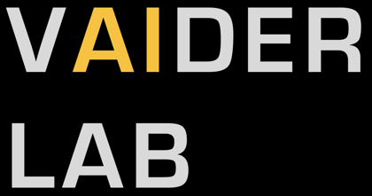

# VAIDER-mask

**Veterinary DICOM anonymizer** from the VAIDER Lab (Veterinary AI in Diagnostic Imaging and Radiotherapy).

VAIDER-mask removes owner, patient and clinic identifiers from veterinary CT, MR and radiotherapy DICOM (images, RTSTRUCT, RTPLAN, RTDOSE, RTIMAGE), and from DICOM radiographs (X-ray mode, see [README_XRAY.md](README_XRAY.md)). It runs only on your own computer: no network calls, no telemetry, no AI in the loop. It starts a small local web page (127.0.0.1) for choosing folders and reviewing results.

> **Status: draft v0.4.0. Not validated on real veterinary data.** CT mode is tested on synthetic data, 15 public phantom and human test-patient radiotherapy exports and one already-anonymized veterinary head-and-neck set (see [Tested on](#tested-on)). X-ray mode is new and tested on synthetic radiographs only. Test on phantom or synthetic data first, have a second person check the output against a tag dump, and confirm with your own institution's rules before sharing any data. No pixel scrubbing: burned-in text in images is not removed. Provided as is, with no warranty (see the license).

## Quick start

1. Install Python 3.
2. Mac: open Terminal, type `cd ` (with a space), drag the VAIDER-mask folder into the window, press Enter, then run `bash START_Mac.command`. (Double-clicking `START_Mac.command` also works once macOS allows it: if it says "Not Opened", go to System Settings → Privacy & Security and click Open Anyway; if it says you do not have access privileges, run `chmod +x START_Mac.command` in that folder first.) Windows: double-click `START_Windows.bat`.
3. The first run creates a private Python environment in your home folder and installs `pydicom` and `numpy` (needs internet once). A page opens in your browser. Choose **CT / MR / radiotherapy** or **X-ray** in section 0; the rest of the page follows.
4. Check the install: `python3 scripts/selftest.py` builds synthetic CT/RT patients and radiographs in a temporary folder, runs both modes and checks the output independently. It should end with `31/31 checks passed`.
5. Try it on synthetic data: `python3 scripts/make_test_data.py <folder>` creates eight Pinnacle-style test patients with 45 slices each (all identifiers invented). A first run with default settings writes five of them; three fail on purpose (too few slices, a missing orientation tag, a structure set whose frame matches no CT), and a dose-report screenshot is skipped.

Use the Python from the private environment if `pydicom` is not installed system-wide: `~/.vaider/envs/VAIDER-mask/bin/python` on Mac, `%USERPROFILE%\.vaider\envs\VAIDER-mask\Scripts\python.exe` on Windows.

## What it does

- Reads a file or a folder tree, including raw DICOM with no preamble or `DICM` header (Corvus, XiO, GE AW exports) under any file extension. Pinnacle-style patient folders (`dicom_output_N` with `rtstruct_N.dcm`, `rtplan_N.dcm`, ...) form one scan set each; `ImageSet_N.DICOM` copies are never output. Other layouts are grouped by DICOM series.
- Keeps each structure set, plan, dose and portal image (RTIMAGE) with the images it belongs to, following the references between them (dose → plan → structure set → CT). Files that belong to the same animal but carry a different PatientID or clinic name (Pinnacle sometimes writes the RTSTRUCT's PatientID differently; Eclipse may put the clinic only on the plan) are joined to that animal and flagged on the page. RT files that match no image series are not written.
- Writes `DEID_DATA/<NewID>/set_NN/<MOD>/<MOD>_nnnn.dcm`, one folder per scan set, plus `deid_sets.csv` (per set: species, breed, sex, age, region, CE / No CE, orientation, frame match, checks), `deid_index.csv` and `run_report.json`. No original names appear in `DEID_DATA`. Every output file is standard DICOM with a new file header: only the SOP class, the new SOP UID, the transfer syntax and VAIDER-mask's name (no AE titles, network addresses or private data from the source).
- Writes the key (`crosswalk_*.csv`, `anonymization_report.csv`, UID secret) to a separate restricted folder. Never share or commit it.
- New patient IDs are assigned once, stored in the key, and reused in later batches. Each site numbers its own patients.
- Replaces name, ID, physician and institution (at every level, including inside plan beam sequences); removes owner, staff, station, accession and private tags at every level; shifts dates per animal by 30 to 364 days; remaps every instance UID consistently (HMAC), in the dataset and the file header; redacts the patient's, owner's and staff names and the IDs and accession number in free text by whole-word match, never touching structure names (ROIName).
- Verifies the output from disk: leftover identifying text, removed tags at any level, unchanged pixels, file header UID, unresolved references (references already broken in the source are reported separately and do not fail the run), structure-set frame matches images.
- QC gates per set (skipped by default if failed): minimum distinct slice positions (default 41), verifiable geometry, matching frame of reference, at least one image series, not a screenshot (secondary capture images such as scanner dose reports or photos are never written).
- Warns when a structure name (ROIName) contains the animal's or owner's name or an ID; structure names themselves are not changed.
- Optional filling of missing orientation tags, and a quadruped option.

## Defaults you may want to change

Replacement values such as the name suffix and institution (`CornellRT`), physician (`BigRed^Dr`), ID prefix (`Z00`) and site label are defaults in the page; set your own.

## Files

- `scripts/core.py` engine (all de-identification logic)
- `scripts/server.py` local server, `scripts/index.html` the page
- `scripts/make_test_data.py` synthetic CT/RT generator; `scripts/make_xray_test_data.py` synthetic radiograph generator
- `README_XRAY.md` X-ray mode: what it reads, skips, removes, changes and keeps
- `scripts/selftest.py` end-to-end self-test
- `CHANGELOG.md` what changed between versions

## Tested on

All runs used default settings except a minimum slice count of 0 for the sets with fewer than 41 slices. Every output file was then searched independently, file header included, for any name, ID, clinic, staff name or UID from the source. None of these are animal data; no public veterinary CT with structure sets was found.

| Data | Source | Result |
|---|---|---|
| Synthetic test patients (`make_test_data.py`) | this repository | 5 of 8 patients written as designed, no leaks |
| Pinnacle3 9.6 prostate, real patient (187 CT + RTSTRUCT) | [SlicerRtData](https://github.com/SlicerRt/SlicerRtData/tree/master/pinnacle3-9.6-prostate-poi-and-contour) | all written, no leaks |
| Pinnacle3 8.2g chest phantom; 9.9 phantom; 9.9 IMRT phantom | [SlicerRtData](https://github.com/SlicerRt/SlicerRtData) | all written (9.9: 9 files for a plan on a CT not in the download correctly skipped), no leaks |
| Eclipse 8.1 prostate and head-and-neck phantoms; Eclipse 11 lung | [SlicerRtData](https://github.com/SlicerRt/SlicerRtData) | all written, no leaks |
| RTOG 0522 head-and-neck, real patient | [SlicerRtData](https://github.com/SlicerRt/SlicerRtData/tree/master/rtog-head-and-neck-cetuximab) | all written, no leaks |
| XiO irregular spacing; Oncentra tilted plane; CERR chest; Corvus phantom | [SlicerRtData](https://github.com/SlicerRt/SlicerRtData) | all written, no leaks |
| GE AW foot (raw `.v2` files) | [SlicerRtData](https://github.com/SlicerRt/SlicerRtData/tree/master/aw-4.4-foot) | planning CTs + RTSTRUCT + RTPLAN written; 4 scanner dose-report screenshots skipped as screenshots; no leaks. Ends "with problems": 4 references point to files not in the download |
| HIT head (CT, MR, SR, RTRECORD, RTIMAGE, ...) | [SlicerRtData](https://github.com/SlicerRt/SlicerRtData/tree/master/HIT-H1-head) | planning CT + RTSTRUCT written; a patient photo and a 3D-fusion screenshot skipped as screenshots; treatment records and SR not linked to an image series skipped; no leaks. Ends "with problems": 1 reference to a file not in the download |
| The Pinnacle 9.6, RTOG and Pinnacle 9.9 IMRT sets re-laid out as Pinnacle `dicom_output_N` folders with invented owner, phone, clinic and staff names planted in top-level, nested, free-text and private tags | built from the above | all written, no leaks |
| Veterinary head-and-neck RT (2 animals, 4 Pinnacle CT sets + RTSTRUCT, RTPLAN, RTDOSE), already anonymized before the run | VAIDER Lab | all 397 files written, no leaks; 4 RT files rejoined to their animal |
| Synthetic radiographs (`make_xray_test_data.py`), X-ray mode | this repository | 4 images for 3 animals written as designed; burned-in images, screenshot and non-radiograph files skipped; no leaks |

Untested so far: [4D-Lung](https://doi.org/10.7937/K9/TCIA.2016.ELN8YGLE) (TCIA, real patients, Pinnacle3 structure sets).

## Known limits

- X-ray mode: text burned into radiographs (clinic, date, names) is not removed. Images marked BurnedInAnnotation=YES are skipped, but many systems leave that tag empty; those are written and counted, and must be looked at. See [README_XRAY.md](README_XRAY.md).

- No pixel scrubbing. Secondary-capture images (screenshots, photos) are skipped, but burned-in text in ordinary CT or MR slices is not detected; check images flagged `burned_in_flag` in `deid_sets.csv`.
- Multi-frame and compressed images not tested.
- Structure names (ROIName) are never redacted. A contour named after the animal stays in the output; the page warns about it.
- Free text is scanned for the patient's, owner's and staff names and the IDs, not for anything else (addresses or phone numbers typed into a comment field are only removed if the whole field is in a removal list).
- Not a substitute for institutional review.

## Acknowledgements

VAIDER-mask is built on the Pinnacle de-identification pipeline developed by **Morwen Xu** in the VAIDER Lab. Thank you, Morwen, for the original scripts and for the problems you found and fixed along the way.

## License

GNU General Public License v3.0. See `LICENSE`.
